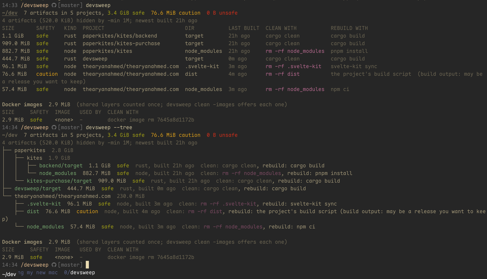

# devsweep

**Find and clean what's eating a developer's disk, without losing anything that matters.**

`target/`, `node_modules`, `.venv`, Docker images, old Node and Rust versions, AI models, tool caches: devsweep shows
what takes the space, how safe each piece is to remove, and cleans it with each tool's own command, asking first.



- **Git decides what's safe.** Anything git tracks is left alone; anything it doesn't ignore is asked about one by one.
- **Each tool cleans its own mess.** `cargo clean`, `mix clean`, `swift package reset`. `rm -rf` only where no tool
  can, and only for real with `--dry-run=false`.
- **The whole disk, not just projects.** Docker, local AI models, old toolchains, simulator runtimes and about 50 tool
  caches, all in one place.

## Install

```sh
brew install thearyanahmed/tap/devsweep
```

Or grab a binary for macOS or Linux from [Releases](https://github.com/thearyanahmed/devsweep/releases), or build it
with `cargo install --git https://github.com/thearyanahmed/devsweep` (Rust 1.88+).

## Use

```sh
devsweep                      # what's in your home folder, plus Docker and local models
devsweep why                  # where did my disk go? one screen
devsweep -tree                # as a tree of folders
devsweep -caches -toolchains  # also shared caches and old Node/Rust/Python versions

devsweep clean                # clean what's safe, after one yes
devsweep clean -pwd           # just the project you're in
devsweep clean -until 30G     # just enough to leave 30 GiB free
devsweep clean --dry-run      # show what would run, run nothing
```

| Safety | Means | `clean` |
| --- | --- | --- |
| **safe** | the project's tooling recreates it exactly | asked once for all |
| **caution** | recreatable, but may differ or hold something you want | with `-upto caution`, one by one |
| **unsafe** | git tracks files in it | with `-upto unsafe`, typing each name |

It knows Rust, Node, Python, Go, Swift, Zig, Elixir and CMake projects, and you can teach it more in a few lines of
Rust. `devsweep -h` lists every flag.

**[Full reference →](docs/reference.md)**: every flag, what each kind cleans, Docker, caches, toolchains, safety
rules, and writing your own sweeper.

## Contributing

`make test` runs clippy with every lint as an error, then the tests. See [CONTRIBUTING.md](CONTRIBUTING.md) and the
[changelog](CHANGELOG.md).

## License

[MIT](LICENSE-MIT) or [Apache-2.0](LICENSE-APACHE), at your option.
